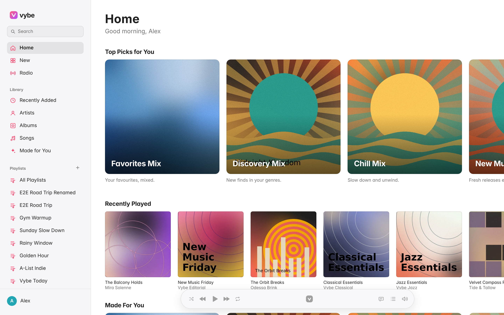
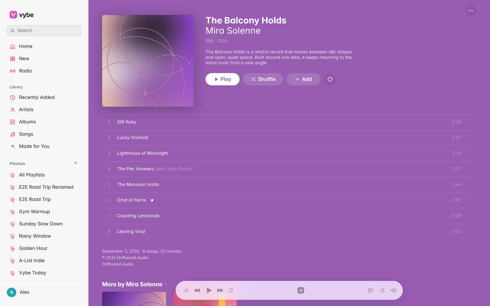
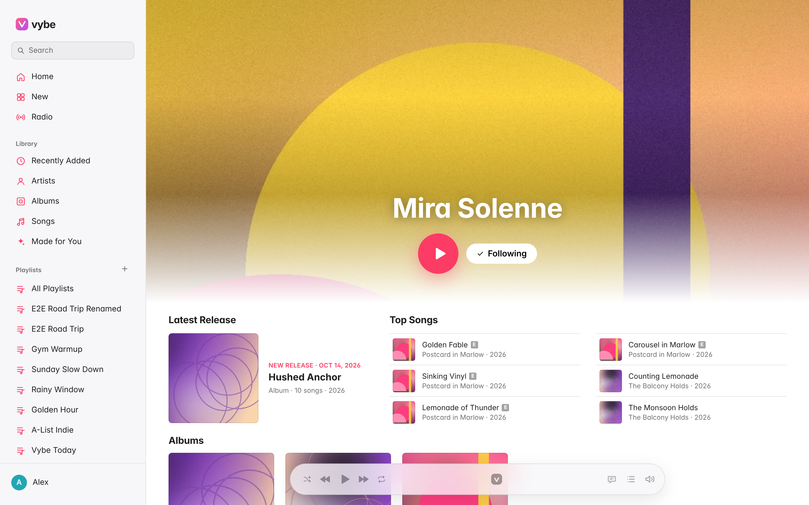
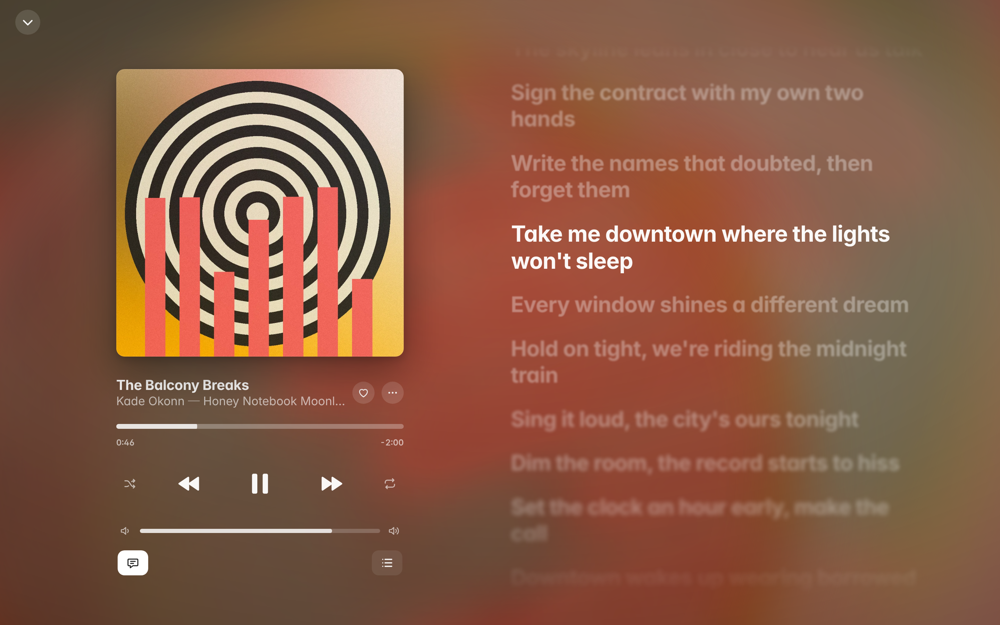
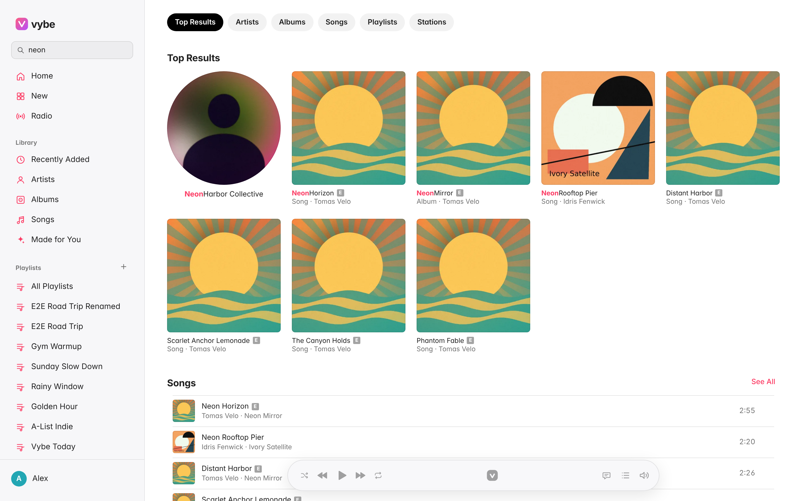
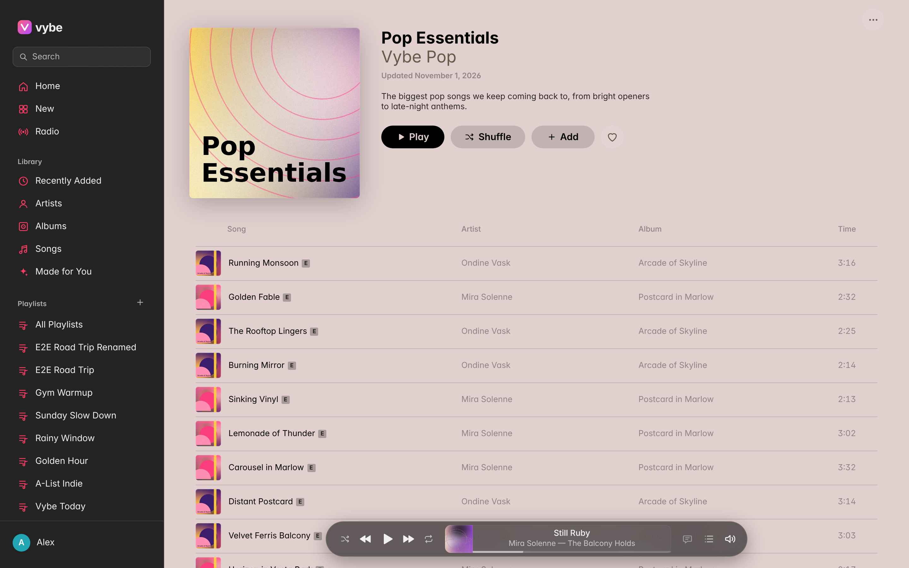
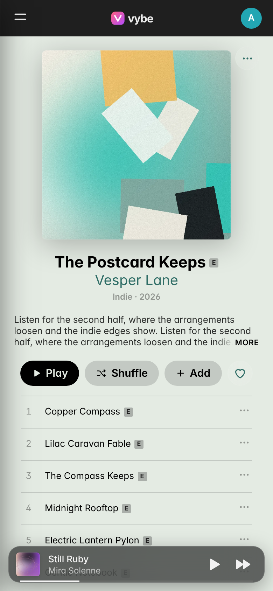

# Vybe

Built by **[Yadav Saurav](https://github.com/yadav-saurav)**.

A premium music streaming web app: curated playlists, personalized discovery, synced lyrics, a queue and seamless playback. Its layout and interaction patterns follow Apple Music on the web. Everything else is original to Vybe: the brand, icons, catalog, artwork, lyrics and audio.



| Album | Artist | Now Playing |
|---|---|---|
|  |  |  |
| **Search** | **Playlist (dark)** | **Mobile** |
|  |  |  |

## Features
- **Browse:** Home (personalized when signed in), New, Radio, genre rooms and stations.
- **Detail pages:** Album and Playlist pages tinted from the artwork palette. Artist pages have a hero, Top Songs, discography, similar artists and an About section.
- **Search:** typo-tolerant ranking, live suggestions with keyboard navigation, results tabs and recent searches.
- **Library:**
  - Recently Added, Artists, Albums, Songs (filter and sort) and Made for You (personal mixes).
  - Playlists you can create, rename, reorder by drag or keyboard, and delete.
  - Favourites, and following artists.
- **Player:**
  - A floating player bar (desktop) and a mini player (mobile).
  - Full-screen Now Playing with synced, clickable lyrics.
  - A queue with Playing Next, History and Autoplay, reorderable by drag.
  - Shuffle and repeat (all or one), and gapless-style preloading.
  - Media Session (OS media keys) and keyboard shortcuts.
  - Playback resumes where you left off after a reload.
- **Accounts:** sign up and sign in with a session cookie. Listening history drives recommendations, mixes and Recently Played.
- **Appearance:** light, dark or system theme, a responsive layout from 390px up, and support for reduced motion.

## Stack
| Part | Tech |
|---|---|
| Web (`apps/web`) | React 19, TypeScript, Vite, React Router 7, Zustand, CSS Modules with design tokens |
| API (`apps/api`) | Java 21, Spring Boot 3.5 (Web MVC, JDBC), SQLite, JUnit 5 + MockMvc |
| Shared contract (`packages/shared`) | TypeScript domain types and the documented HTTP API |
| Catalog (`scripts/`) | Python (numpy, Pillow) plus ffmpeg. It generates the original artists, albums, songs, artwork, synthesized audio and timed lyrics |

## Run locally
You need Node 22+, Java 21+ (Maven wrapper included), Python 3 with numpy and Pillow, and ffmpeg.

```bash
npm install
```
Generate the media. This takes about 11 minutes and produces about 925 MB, which isn't stored in git:
```bash
npm run generate:catalog
```
Start the API (port 4000) and the web app (port 5173):
```bash
npm run dev
```

Open http://localhost:5173 and sign in with the demo account **demo@vybe.app** / **vybe1234**. It comes pre-seeded with a library, playlists and listening history.

**Production (single server):** `npm start` builds the web app and the API jar, then serves everything from http://localhost:4000.

**Tests:** `npm test` runs the web unit tests (Vitest) and the API tests (JUnit).

## Docker
```bash
docker compose up --build
```
Open http://localhost:4000.
- The first run generates the catalog into a volume, which takes about 11 minutes. Later runs skip this step.
- The database and imported music live in a separate `state` volume, so they survive restarts.
- The image runs as a non-root user and includes a health check.

## Docs
- [`docs/DESIGN.md`](docs/DESIGN.md): the design spec and tokens.
- [`docs/catalog.md`](docs/catalog.md): the catalog generator.
- [`apps/api/README.md`](apps/api/README.md): API architecture and configuration.

## Keyboard shortcuts
| Keys | Action |
|---|---|
| Space | Play / pause |
| ⌘/Ctrl + → / ← | Next / previous |
| Shift + → / ← | Seek ±10s |
| ⌘/Ctrl + ↑ / ↓ | Volume |
| M | Mute |
| L / Q | Toggle lyrics / queue |
| ⌘/Ctrl + F | Focus search |
| Esc | Close Now Playing |
